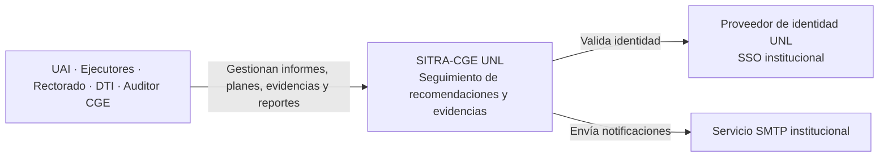
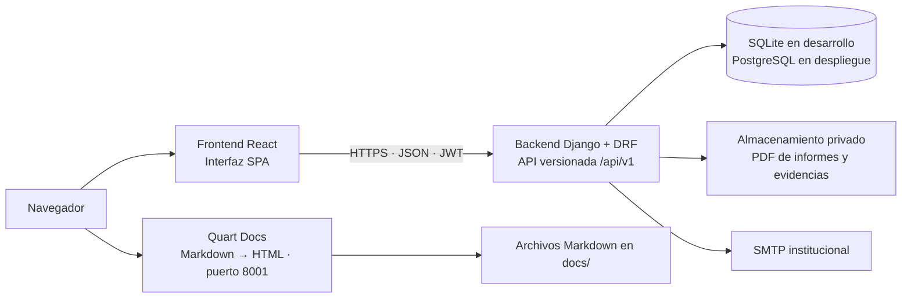
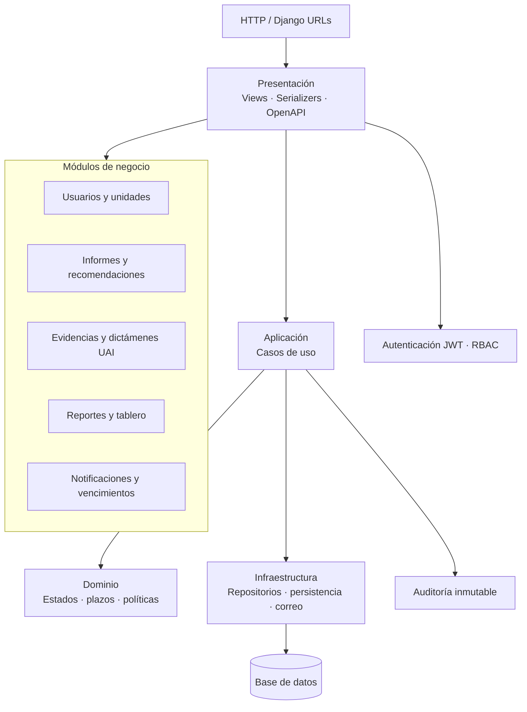

# Arquitectura SITRA-CGE UNL

Documento C4 de la plataforma de seguimiento de recomendaciones de la Contraloría General del Estado para la Universidad Nacional de Loja.

## Nivel 1: contexto

## Nivel 2: contenedores

## Nivel 3: componentes del backend

## Nivel 4: código y datos

- `backend/config/`: configuración, URLs globales, OpenAPI y middleware.
- `backend/core/`: autenticación JWT, permisos, envoltura de API y auditoría.
- `backend/modules/<módulo>/presentation/`: vistas, serializers y rutas HTTP.
- `backend/modules/<módulo>/application/`: casos de uso independientes de HTTP.
- `backend/modules/<módulo>/domain/`: reglas de negocio y transiciones de estado.
- `backend/modules/<módulo>/infrastructure/`: repositorios y acceso a Django ORM.
- `frontend/`: cliente React que consume la API JSON.
- `docs_server/app.py`: servidor asíncrono de documentación Markdown.

Relaciones principales: un `InformeCGE` tiene muchas `Recomendacion`; cada recomendación pertenece a una `UnidadOrganica`, puede tener varios `PlanAccion` y `Evidencia`, y puede recibir `DictamenUAI`. `Usuario` identifica al actor; `AuditLog` registra eventos mutativos con inserción únicamente. La evidencia almacenada se mantiene privada y se sirve mediante endpoints autorizados.

## Operaciones, despliegue y mantenimiento

### Desarrollo

1. Configurar `DJANGO_SECRET_KEY`, `DJANGO_DEBUG` y los orígenes CORS. En desarrollo se usa SQLite si no se configura PostgreSQL.
2. Instalar `backend/requirements.txt`, ejecutar `python backend/manage.py migrate` y arrancar con `python backend/manage.py runserver`.
3. Instalar `docs_server/requirements.txt` y arrancar el lector con `python docs_server/app.py`. La portada lista los archivos Markdown de `docs/`.
4. Consultar Swagger UI en `/api/docs/` y el esquema OpenAPI 3.0 en `/api/schema/`.

### Despliegue

- Desplegar Django detrás de un servidor ASGI/WSGI y proxy TLS; configurar `DEBUG=false`, clave secreta, hosts, PostgreSQL y CORS explícitos.
- Ejecutar migraciones como paso controlado del despliegue y servir archivos privados fuera del directorio estático.
- Ejecutar Quart como servicio separado, detrás del proxy, apuntando a la misma carpeta `docs/`.
- Configurar copias de seguridad cifradas de PostgreSQL y archivos PDF, y comprobar periódicamente su restauración.

### Mantenimiento

- Revisar logs de aplicación, respuestas de salud y errores de integración SSO/SMTP.
- Mantener dependencias y migraciones versionadas; probar restauraciones antes de actualizar la base de datos.
- Los registros `AuditLog` son inmutables. No modificar ni borrar evidencia en el almacenamiento directamente.
- Regenerar y revisar el contrato con `python backend/manage.py spectacular --file backend/contracts/openapi.yaml` al cambiar endpoints.
