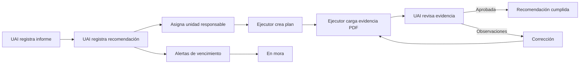

# Hoja de ruta de SITRA-CGE UNL

## 1. ¿Qué problema resolvemos?

La Universidad necesita saber qué recomendaciones de la Contraloría General del
Estado están pendientes, quién debe atenderlas, qué evidencia existe y si la
Unidad de Auditoría Interna la aprobó.

SITRA-CGE UNL reemplaza hojas dispersas y seguimiento manual por un flujo visible:



## 2. Qué se construirá primero

### MVP

El MVP es el camino mínimo que demuestra valor institucional:

1. Registrar un informe CGE.
2. Registrar y asignar una recomendación.
3. Crear un plan de acción.
4. Cargar una evidencia PDF.
5. Calcular y verificar SHA-256.
6. Revisar, aprobar o devolver la evidencia.
7. Impedir que una recomendación pase a cumplida sin revisión UAI.
8. Registrar el historial de cambios.

### Segunda entrega

- Alertas de vencimiento y estado `En Mora`.
- Dashboard para Rectorado.
- Auditoría de solo lectura para CGE.
- Exportación de la matriz institucional.

### Fuera de la primera versión

- Sincronización automática con la base de datos de la CGE.
- Gestión de responsabilidades penales o judiciales.
- Aplicación móvil nativa.

## 3. Metodología elegida

Se utilizará **Spec-Driven Development (SDD) con Scrum ligero y Kanban**:

- **SDD** define qué se construye antes de programar.
- **Scrum ligero** organiza entregas semanales y una demostración al final de cada
  semana.
- **Kanban** muestra el estado de cada tarea: Pendiente, En progreso, En revisión,
  Bloqueada y Terminada.
- **GitHub Issues y Pull Requests** mantienen el historial verificable.

### Ciclo de una funcionalidad

```text
Idea
  -> Requisito
  -> Criterio de aceptación
  -> Plan técnico
  -> Tareas
  -> Código
  -> Prueba
  -> Revisión
  -> Documentación
  -> Demostración
```

Ninguna funcionalidad se considera terminada si no tiene prueba, documentación y
evidencia de demostración.

## 4. Tecnología elegida

| Área | Decisión | Motivo comprensible |
|---|---|---|
| Backend | Python 3.12 + Django REST Framework | Ecosistema maduro, adecuado para reglas institucionales y APIs |
| Base de datos | PostgreSQL 16 | Integridad, transacciones y relaciones complejas |
| Frontend | React + TypeScript + Vite | Interfaces claras y tipadas, fáciles de dividir por módulos |
| API | REST + OpenAPI 3.1 | Contrato visible entre frontend y backend |
| Pruebas backend | pytest | Pruebas unitarias, integración y reglas de dominio |
| Pruebas frontend | Vitest + React Testing Library | Pruebas de componentes y flujos de usuario |
| Pruebas completas | Playwright | Comprueba el sistema como lo usaría una persona |
| Archivos | Almacenamiento compatible con S3 o volumen institucional | Separa documentos de los datos transaccionales |
| Notificaciones | SMTP institucional mediante adaptador | Evita acoplar el dominio al proveedor |
| Calidad | Ruff, mypy, ESLint, Prettier y detección de secretos | Reduce errores antes de integrar |
| Entorno | Docker Compose para desarrollo | Todos trabajan con servicios equivalentes |

La decisión técnica queda registrada en la versión actual del plan. Si el docente
o la infraestructura institucional exige otra tecnología, se debe crear un ADR
antes de cambiarla.
