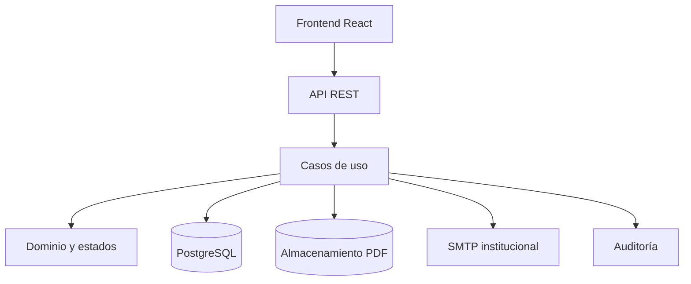

# Manual técnico de SITRA-CGE UNL

**Estado**: guía viva de desarrollo  
**Versión**: 0.1.0  
**Última actualización**: 2026-10-20

## 1. Propósito

Este manual explica cómo instalar, entender, probar y mantener SITRA-CGE UNL.
Describe el sistema para desarrolladores y responsables técnicos, no para usuarios
finales.

## 2. Arquitectura

El backend se divide en Presentación/API, Aplicación, Dominio e Infraestructura.
Las reglas de recomendaciones viven en el dominio y no deben depender del ORM,
PostgreSQL o el proveedor de archivos.



## 3. Instalación local

El bloque ejecutable actual usa SQLite para desarrollo rápido; PostgreSQL queda
como adaptador de persistencia del siguiente tramo. Para levantar la API y la
vista de demostración:

```powershell
Set-Location backend
python -m pip install -e ".[test]"
python manage.py check
python manage.py migrate
python -m pytest -q
python manage.py runserver
```

Luego abrir `http://127.0.0.1:8000/`. La vista HTML consulta el endpoint
`/api/v1/recomendaciones`; el endpoint `/health/` sirve como comprobación rápida.
El login actual es un adaptador de desarrollo y no reemplaza el SSO institucional.
Las evidencias PDF tienen un límite de 30 MB por archivo.

Nunca se deben colocar contraseñas reales en este archivo ni en Git.

## 4. Contrato y seguridad

La API usa `/api/v1/`, la envoltura universal y `request_id`. Todo endpoint debe
validar autenticación, rol y pertenencia a la dependencia. El contrato completo se
encuentra en [`openapi.yaml`](../specs/001-seguimiento-recomendaciones/contracts/openapi.yaml).

## 5. Pruebas

La validación mínima incluye:

- reglas de la máquina de estados;
- carga y hash de PDF;
- autorización BOLA entre dependencias;
- auditoría;
- concurrencia;
- respuestas de error;
- escenarios completos del [quickstart](../specs/001-seguimiento-recomendaciones/quickstart.md).

## 6. Mantenimiento

Antes de modificar una regla:

1. localizar el RF/RNF en la especificación;
2. revisar la tarea y el contrato afectados;
3. actualizar prueba;
4. implementar;
5. actualizar esta documentación;
6. registrar la decisión si cambia la arquitectura.

## 7. Configuración institucional de SSO, SMTP y almacenamiento

La configuración se toma de variables de entorno y nunca se almacena en la base
de datos ni en el repositorio:

| Variable | Uso | Valor local sugerido |
| --- | --- | --- |
| `SSO_ISSUER` / `SSO_CLIENT_ID` | Proveedor institucional de identidad | valores entregados por DTI |
| `EMAIL_HOST` / `EMAIL_PORT` | Servidor de correo institucional | vacío / `587` |
| `EVIDENCE_STORAGE_BACKEND` | Adaptador de almacenamiento de evidencias | `local` |
| `DJANGO_MEDIA_ROOT` | Volumen o ruta de almacenamiento de evidencias | `./media` |
| `POSTGRES_*` | Conexión PostgreSQL de producción | definidas por operación |

Procedimiento:

1. Copiar `backend/.env.example` a un archivo local excluido por Git.
2. Completar únicamente las variables del entorno; no escribir contraseñas en
   `settings.py`, migraciones ni documentación.
3. Para SSO, registrar la URL de retorno institucional y validar el token con el
   adaptador de `backend/modules/usuarios/infrastructure/sso_adapter.py`.
4. Para SMTP, verificar el remitente institucional y ejecutar una prueba de envío
   con una cuenta de servicio.
5. Para almacenamiento, montar el volumen con permisos de escritura para el proceso
   Django y respaldarlo junto con la base de datos.

### Configuración de notificaciones

El rol `DTI` administra los umbrales, destinatarios y canales desde
`PUT /api/v1/notificaciones/configuracion`. Cada usuario puede ajustar sus
preferencias por tipo de alerta desde `PUT /api/v1/notificaciones/preferencias`;
solo el propio usuario o `DTI` pueden consultarlas. Los cambios quedan en
`AuditLog` y las credenciales SMTP permanecen exclusivamente en el entorno.
