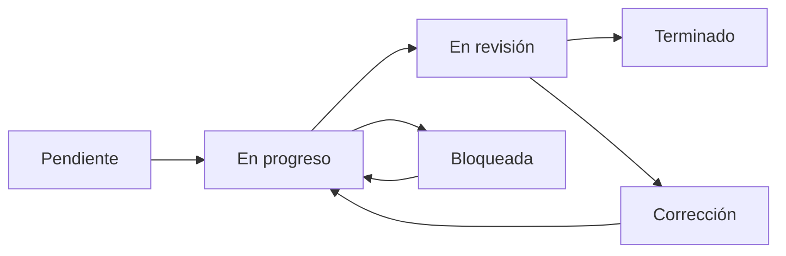

# Trazabilidad explicada

## 1. Cómo leer esta página

Una persona no técnica puede seguir una funcionalidad de izquierda a derecha:

```text
Necesidad humana
  -> Requisito RF
  -> Historia de usuario
  -> Tarea T
  -> Archivo de código
  -> Prueba
  -> Evidencia de demostración
  -> Manual
```

Si falta una flecha, el trabajo no está completamente demostrado.

## 2. Ejemplos principales

| Necesidad | Requisito | Historia | Tareas iniciales | Prueba | Evidencia para revisión |
|---|---|---|---|---|---|
| Registrar una recomendación y saber quién la atiende | RF-005, RF-006 | US1 | T023-T032 | Registro completo y validación de campos | Captura del formulario y registro creado |
| Cargar un documento que demuestre avance | RF-007, RF-008 | US2 | T033-T043 | PDF válido, PDF inválido y BOLA | Captura de carga, hash y estado |
| Evitar declarar cumplimiento sin revisión | RF-009, RF-010 | US3 | T044-T052 | Salto ilegal devuelve 409 | Video o captura del rechazo y bitácora |
| Avisar que se acerca un vencimiento | RF-011, RF-012 | US4 | T053-T062 | Umbral, reintento y mora | Registro de notificación y tablero |
| Permitir una revisión externa | RF-014, RF-017, RF-018 | US5 | T063-T072 | Auditoría, hash y exportación | Matriz y consulta de historial |
| Gestionar el acceso de una persona | RF-001, RF-002, RF-003 | US6 | T073-T080 | Roles, dependencia y reasignación | Captura de permisos y auditoría |

## 3. Registro por tarea

Cada Pull Request debe incluir una tabla como esta en su descripción:

| Campo | Ejemplo |
|---|---|
| Historia | US2 - Gestionar plan y evidencias |
| Requisitos | RF-007, RF-008, RNF-001, RNF-003 |
| Tareas | T033, T036, T037, T041 |
| Archivos | `backend/core/files/pdf_integrity.py` |
| Pruebas | `backend/tests/unit/test_mvp.py` |
| Evidencia | Captura o enlace a ejecución de prueba |
| Manual afectado | Manual técnico, sección Evidencias |

## 4. Estados visibles para el equipo



## 5. Definición de terminado

Una tarea se marca `[X]` en `tasks.md` solo cuando:

- el código está implementado;
- la prueba correspondiente pasa;
- no rompe una regla de seguridad;
- el Pull Request fue revisado;
- la trazabilidad RF/RNF está actualizada;
- el manual correspondiente fue actualizado;
- existe evidencia para la demostración.
